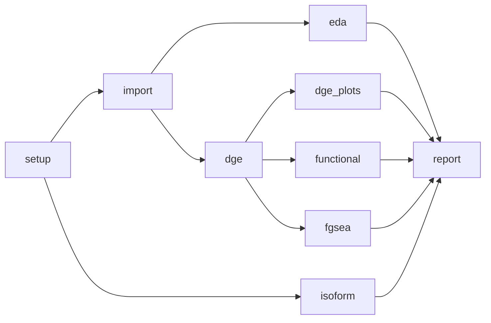

<p align="center">
  
</p>

<h1 align="center">ExpressOM</h1>

<p align="center">
  Bulk RNA-seq analysis toolkit
</p>

<p align="center">
  
</p>

**ExpressOM** is a fully modularized R package for bulk RNA-seq analysis. It wraps `tximport`, `DESeq2`, `clusterProfiler`, `SPIA`, `fgsea`, and `Enrichr` into a streamlined, automated workflow. 

It effortlessly handles counts import, exploratory data analysis (EDA), differential expression analysis, comprehensive visualizations, and functional enrichment (GO, Reactome, Disease Ontology, KEGG, Transcription Factors, SPIA, and GSEA). Species currently supported: **Human** and **Mouse**.

Besides the analysis itself, ExpressOM gives you:

* **one interactive HTML report** per run (plotly figures and searchable tables in tabs) -- [see below](#interactive-html-report);
* **a Shiny app** to change parameters and relaunch the analysis on the fly, and browse the results -- [see below](#shiny-app);
* **an incremental `targets` pipeline** that only re-runs the stages affected by a change -- [see below](#incremental-runs-with-targets);
* **a `testthat` suite** that runs without real data -- [see below](#tests).

---

## Installation

You can install the package directly from your local source directory using `devtools` or `remotes`:

```R
# Install devtools if not installed
if (!requireNamespace("devtools", quietly = TRUE)) install.packages("devtools")

# Install directly from GitHub
devtools::install_github("lavauxt/ExpressOM")
```

The analysis itself only needs the core packages listed in `DESCRIPTION`. The interactive report, the Shiny app and the incremental pipeline use a few extra (optional) packages, which `validate_environment()` checks before a run:

```R
install.packages(c(
  "rmarkdown", "knitr", "htmltools", "htmlwidgets", "plotly", "DT", "pdftools",  # HTML report
  "shiny", "targets", "callr", "tidyselect"                                      # app + targets pipeline
))
```

The report also needs [pandoc](https://pandoc.org/) (bundled with RStudio / Positron).

### 1. Generate and Install the Custom Ensembl Database
`ExpressOM` relies on a custom-built Ensembl database package to annotate transcripts and map identifiers securely. You must build and install it locally before processing your data.

```R
library(ExpressOM)

ExpressOM::run_bulk_pipeline(
  ensembl_package_name = "EnsDb.Hsapiens.v107", 
  data_dir = "./raw_data",
  out_dir = "./results"
)
```

### 2. Automated Ensembl Annotation Database Handling

The pipeline fully automates annotation package installation. If the package assigned to the `ensembl_package_name` parameter (e.g., `"EnsDb.Hsapiens.v107"`) is missing from the local R environment, the runtime automatically:
1. Parses out the target species (`human` or `mouse`) and Ensembl release version (`107`).
2. Fetches appropriate remote `.gtf` files and generates a custom backend mapping table (`create_homemade_db`).
3. Bundles and local-installs the structured R package wrapper securely on the fly.

> 💡 **Tip:** Use https://www.gencodegenes.org/ to check for the correct Ensembl version for Human and Mouse

Every run starts with a pre-flight dependency check (`validate_environment()`): missing core packages (`DESeq2`, `tximport`, `dplyr`, `ggplot2`, `pheatmap`) stop the run immediately with a clear install message, while missing functional-analysis or isoform-analysis packages (only relevant if `run_dge`/`run_isoform` are enabled) produce an early warning instead of failing hours into a run.

---

## Data Preparation

The pipeline expects a specific directory structure for your quantification tools (`salmon`, `kallisto`, `rsem`, `stringtie`, etc.) or raw count matrices (`matrix` mode).

**Sample Table (`sample_table.csv` / `.tsv`) Format:**
Your sample table must contain a column identifying each sample (sample_id or Sample), along with factors used in your model (e.g., genotype, cell type, batch). This format is directly compatible with DESeq2, which uses it to perform differential expression analysis (DEG) in the pipeline.

| sample_id | genotype | cell_type  | batch |
|-----------|----------|------------|-------|
| Sample1   | WT       | T_cell     | 1     |
| Sample2   | KO       | T_cell     | 1     |
| Sample3   | WT       | B_cell     | 2     |

- **`sample_id`**: Unique identifier for each sample. This should match the filenames of your count or expression data.  
- **Factors (`genotype`, `cell_type`, `batch`)**: Variables to include in your DESeq2 model for differential expression analysis. These are used to build the design formula (e.g., `~ batch + cell_type + genotype`).  
- **File type**: Accepts **CSV** or **TSV**.  

> 💡 **Tip:** DESeq2 expects this table to be complete, with no missing sample IDs, and all factor columns properly formatted (as `factor` in R).

---

## Usage

### Example 1: Matrix Input (e.g. standard Read Counts)
Used when importing pre-quantified text files (like `raw_counts.csv`).

```R
library(ExpressOM)

run_bulk_pipeline(
  ensembl_package_name = "EnsDb.Mmusculus.v114",        # Ensure you use the exact database name
  count_type = "matrix",
  matrix_file = "./data/matrix_raw_counts.csv",
  sample_table = "./data/sample_table.tsv",
  out_dir = "./result_matrix",
  model = "~ cell_type + genotype + cell_type:genotype", # Design formula DESeq2 style
  level = "KO",                                          # Active/Treatment group
  base = "WT",                                           # Reference/Baseline group
  padj_cutoff = 0.05
)
```

### Example 2: Transcriptomic Input (`salmon`, `kallisto`, `rsem`)
Provide the base `data_dir` containing subfolders matching your `sample_id` column. `tximport` will automatically look for the expected file name (e.g. `quant.sf` for `salmon`, `abundance.tsv` for `kallisto`).

```R
run_bulk_pipeline(
  ensembl_package_name = "EnsDb.Hsapiens.v107", # Ensure you use the exact database name
  count_type = "salmon",                        # Options: "salmon", "kallisto", "rsem", "stringtie", etc.
  data_dir = "./data/counts",  
  out_dir = "./results_classic",
  sample_table = "./data/sample_table.csv",
  model = "~ condition",                        # Design formula DESeq2 style
  level = "Treated",                            # Active/Treatment group
  base = "Control"                              # Reference/Baseline group
)
```

## PCA, Volcano and DEG-count Options

```R
run_bulk_pipeline(
  # ... usual arguments ...
  sample_labels    = "./data/sample_labels.csv",           # relabel samples on every PCA (file, data.frame or named vector)
  pca_colors       = c(level = "red2", base = "royalblue"), # defaults shown
  volcano_colors   = c(up = "red2", down = "royalblue", ns = "grey"), # defaults shown
  deg_lfc_cutoff   = 1,                                    # |log2FC| used by the volcano and the DEG count table
  deg_padj_cutoffs = c(0.01, 0.05)                         # DEG counts + DEG lists saved for each adjusted p-value
)
```

* **`sample_labels`** – changes the names printed on all PCA plots (global, batch-corrected, comparison-only and transcript-level). Pass a CSV/TSV file, a data.frame, or a named vector (`c(S1 = "Treated rep1")`). In a file, the first column holds the sample IDs exactly as in the sample table and the second the label to print; the header row is optional and `,` / `;` / tab separators are detected automatically (columns named `sample`/`sample_id` and `label`/`new_label` are recognised wherever they are):

  ```csv
  sample,label
  S1,Treated rep1
  S2,Treated rep2
  S5,Control rep1
  ```

  Samples that are not listed keep their own name. The `PCA_*_sample_scores.tsv` tables keep the original ID in `sample_label` and add the printed label as `plot_label`.
* **PCA colours** – the `level` group is drawn in red and the `base` group in blue; any other group of the colouring column gets a distinct colour (green, orange, ...).
* **Volcano** – genes with `padj < padj_cutoff` and `log2FC > deg_lfc_cutoff` are red, those with `log2FC < -deg_lfc_cutoff` are blue, the rest grey. The caption reads `Upregulated: N | Downregulated: M` instead of the total number of genes.
* **`deg_padj_cutoffs`** – writes `DE_raw_results/DEG_counts_<level>_vs_<base>.txt`, one row per adjusted p-value cutoff (the ones you give plus `padj_cutoff`): `n_tested` (genes with an adjusted p-value), `n_sig`, `n_up`, `n_down` (adjusted p-value only) and `n_sig_lfc`, `n_up_lfc`, `n_down_lfc` (also requiring `|log2FC| > deg_lfc_cutoff`). One DEG list per cutoff is saved next to it (`DEgenes_pval_0_01_...txt`, `DEgenes_pval_0_05_...txt`, most significant first). `deg_padj_cutoffs = NULL` keeps only the list for `padj_cutoff`.

## Multi-GMT Pathway Profiling (FGSEA)

The gmt_file parameter accepts a string vector or a standard list object mapping multiple independent gene matrices simultaneously. The workflow loops through each matrix file and saves separate outputs under dedicated subfolders named after the file

```R
# Profile multiple collections in one execution pass
ExpressOM::run_bulk_pipeline(
  gmt_file = c(
    "./gene_sets/h.all.v2023.1.Hs.symbols.gmt",
    "./gene_sets/c2.cp.kegg.v2023.1.Hs.symbols.gmt"
  ),
  out_dir = "./results"
)
```

# Resulting Workspace Tree
```txt
results/
└── GSEA/
    └── FGSEA/
        ├── h.all.v2023.1.Hs.symbols/
        │   ├── Barplot_h.all.v2023.1.Hs.symbols.pdf
        │   ├── GSEA_Table_h.all.v2023.1.Hs.symbols.html
        │   └── GSEA_plot_...pdf
        └── c2.cp.kegg.v2023.1.Hs.symbols/
            ├── Barplot_c2.cp.kegg.v2023.1.Hs.symbols.pdf
            ├── GSEA_Table_c2.cp.kegg.v2023.1.Hs.symbols.html
            └── GSEA_plot_...pdf
```
## Interactive HTML Report

Every run of `expressom()` (alias `run_bulk_pipeline()`) ends with **one self-contained, dynamic HTML file** that gathers all the results of the run in tabs:

```txt
results/ExpressOM_report_<level>_vs_<base>.html
```

(The file sits at the root of `out_dir`, next to `log/`, `Plots/` and `DE_raw_results/`, so the links it contains resolve as-is.)

Open it in any browser, no R needed: figures are interactive `plotly` widgets (zoom, hover, toggle groups, export to PNG) and tables are searchable/sortable `DT` tables with CSV/Excel buttons. A **light / dark switch** in the header re-themes the page, the plotly figures and the tables; see [Dark mode](#dark-mode). The report is **discovery based**: it reads whatever is on disk in `out_dir`, and a tab simply does not appear when the stage behind it was not run (no isoform analysis → no *Isoforms* tab, no FGSEA → no FGSEA sub-tab...).

| Tab | Content |
|---|---|
| **Overview** | Summary boxes (comparison, genes tested, up/down-regulated genes, samples, number of enrichment tables, significant DTE/DTU) and a checklist of which results were found |
| **Samples & QC** | One sub-tab per PCA (global, batch-corrected, comparison-only, transcript-level), plus sample-similarity diagnostics: interactive PC1/PC2 and PC1/PC3 plots, scree plot, sample-scores table, PCA-score correlation and distance heatmaps, MDS and hierarchical clustering where the saved scores allow it |
| **Differential expression** | *Volcano* (your volcano colours, cut-offs and highlighted genes), *MA plot*, *Top genes heatmap*, *Diagnostics* (ranked effects and distribution checks when their input data are available), full *Results table*, *DEG lists* per cut-off |
| **Functional analysis** | By source (gene level, DTE, DTU), method (ORA, GSEA, SPIA, transcription factors) and gene-set collection (including every FGSEA `.gmt`): original top-term plot + full table, with optional interactive enrichment bubbles and gene-set overlap/network views when the source result tables contain the required fields |
| **Isoforms** | DTE, DTU, DEXSeq, variable transcripts, switch plots and the methods used |
| **Figures** | The PDF/PNG figures found under `out_dir`, one sub-tab per output folder: PDFs are converted to PNG and embedded (click to enlarge; needs `pdftools`; up to `max_static_figures` per folder), plus a table listing every file |
| **Run info** | Parameters of the run, logs (`log/`; legacy `log/` folders remain readable) and the list of files produced |

```R
# on by default; the report is rebuilt at the end of every run
expressom(..., make_report = TRUE,
          report_settings = list(
            title         = "Treated vs control",
            heatmap_genes = 75,           # genes on the top-genes heatmap
            top_terms     = 30,           # terms per enrichment plot
            max_points    = 20000,        # points kept per scatter (large volcano plots are thinned)
            highlight_genes = c("TP53", "MYC"),
            theme         = "auto"        # "auto" (follow the system), "light" or "dark"
          ))

# rebuild it later, from the files on disk, without re-running any analysis
build_expressom_report("./results", settings = expressom_report_settings(title = "My study"))

# use the same data in your own R code
res <- load_expressom_results("./results")
res
```

`report_settings` accepts the arguments of `expressom_report_settings()` (`title`, `max_points`, `heatmap_genes`, `top_terms`, `table_rows`, `slim_tables`, `plotly_bundle`, `static_figures`, `max_static_figures`, `static_dpi`, `highlight_genes`, `padj_cutoff`, `lfc_cutoff`, `theme`). If one tab fails to render, the rest of the report is still built and the failed tab shows the error message.

#### Report size and open speed

The defaults are tuned so that even a genome-scale run (tens of thousands of genes, hundreds of thousands of transcripts) produces a report that opens in a browser in well under a second:

* interactive tables embed at most `table_rows` rows (default 5,000, in adjusted-p order, so the most interesting rows stay; the caption of each table says so) and hide the bulky per-row gene-list columns (`slim_tables = TRUE`); every table keeps its CSV / Excel buttons, and the complete files are always in the run folder;
* QC box plots (expression, RLE) send the five-number summary per sample instead of every gene, the p-value histogram sends 20 bins instead of every p-value, and the Q-Q plot is thinned to 2,000 evenly spaced order statistics;
* the report plots embed the smaller `cartesian` build of plotly.js (~1.3 MB instead of ~3.6 MB) when it can be fetched once from `cdn.plot.ly`; offline (or if the download fails) the full bundle that ships with the plotly package is used silently, so building a report never requires internet access. `plotly_bundle = "full"` opts out, `"cartesian"` forces the small build;
* widgets in hidden tabs are not initialised until their tab is first opened (lazy tabs), which keeps the first paint fast.

Set `table_rows = Inf` / `slim_tables = FALSE` in `report_settings` to embed everything again, at the cost of a much larger and slower file; on a 45,000-gene run with 150,000 transcripts the old behaviour can make `pandoc` run out of memory while assembling the single file.

#### Dark mode

The button at the top right of the report switches between light and dark. The report opens in the mode of the viewer's operating system (`prefers-color-scheme`) until the button is used; the choice is then remembered in that browser. To make a report open in a given mode whatever the system says, build it with `theme = "dark"` (or `"light"`) in `report_settings`; the viewer's own choice still wins. Everything follows the switch: page, tabs, DataTables (filters, buttons, pagination), and the plotly figures (background, text, grid, reference lines, highlighted genes), which are re-themed in place without re-drawing. The embedded static figures (PDFs converted to PNG) are plots on a white background, so they stay on a white card in dark mode. Printing always uses the light theme.

> **Replaces `RegionReport`.** The previous `RegionReport/` HTML was a separate static document, centred on the differential-expression results. It was dropped in favour of the report above (the `regionReport`, `pcaExplorer` and `mockery` suggestions are gone). The argument `nBest`, which only controlled it, is now deprecated and ignored. The legacy stand-alone `IsoformSwitch/DTU_DTE_report/DTU_DTE_report.html` is only rendered when you run with `make_report = FALSE` (or call `generate_dte_dtu_report(render_html = TRUE)`); the tables and plots it was built from are always written, and the *Isoforms* tab shows them.

The report needs `rmarkdown`, `knitr`, `htmltools`, `htmlwidgets`, `plotly` and `DT`, and [pandoc](https://pandoc.org/) (bundled with RStudio/Positron). `validate_environment()` warns about them before the run starts, and a run without them still completes (only the report is skipped).

### OmniPathR cache and logging

When decoupleR retrieves networks through OmniPathR, ExpressOM configures the current `omnipathr.*` option names and redirects OmniPathR log output to `log/omnipathr/`. The pipeline writes its other run logs under the lower-case `log/` directory. Existing runs that used `Log/` remain readable; new runs use `log/`.

A stale OmniPathR cache lock is **not removed automatically by default**. OmniPathR's `omnipath_unlock_cache_db()` removes the lock file unconditionally, so it must not be called while another process or `targets` worker may still be using the same cache. Only after all such workers have stopped, an operator can explicitly enable recovery for a run with:

```R
options(ExpressOM.omnipath_unlock_cache = TRUE)
options(ExpressOM.omnipath_lock_stale_after = 600) # seconds; default 10 minutes
```

The option is deliberately opt-in: lock-file age alone cannot prove that its owner is no longer active.

---

## Shiny App

The app lets you **change parameters and relaunch the analysis on the fly**, follow the run, and explore the results, all from one window.

```R
ExpressOM::run_expressom_app()                       # blank form, pick an output directory
ExpressOM::run_expressom_app("./results")            # reopen an existing run (parameters are read back from it)
ExpressOM::run_expressom_app(
  "./results",
  params = list(data_dir = "./raw_data", sample_table = "./samples.csv",
                count_type = "salmon", level = "Treated", base = "Control")
)
```

| Tab | What it does |
|---|---|
| **Pipeline** | One row per stage (*current / stale / running / errored / never run*). The **Run pipeline** button turns red when something is out of date and green when everything is current. *Run selected* builds the stages you tick (and what they depend on); *Force re-run* ignores the cache. The live log is tailed below. |
| **Results** | The same tabs as the HTML report, rendered live in Shiny. Cut-offs and gene counts can be changed for display only, without touching the files on disk. |
| **Report** | Shows the latest HTML report in the app and lets you download it. |

The sidebar holds the parameters (input, design, cut-offs and figures, functional analysis, isoforms, report). Everything else accepted by `expressom()` can be set as JSON in the "other parameters" box; it is checked against the function's argument names before a run starts.


*Screenshots come from a synthetic example run with mocked analysis stages: they show the layout, not real results.*

Runs happen in a background R process (`callr`), so the app stays responsive and a crashed analysis cannot take the app down. Behind the scenes the app uses the `targets` pipeline described below, so **changing a colour or a cut-off only re-runs the stages that read it**. Pass `runner = function(params, dir, stages, force) {...}` to `expressom_app()` to plug in another way of executing the pipeline (this is how the tests exercise the app without running any analysis).

Required packages: `shiny`, `targets`, `callr`, `plotly`, `DT`, `htmltools`, `htmlwidgets`, `rmarkdown`, `knitr`.

---

## Incremental Runs with `targets`

`expressom()` always runs every stage in sequence. For iterative work (tuning cut-offs, colours, gene sets, adding the isoform analysis later) the same stages are available as a [`targets`](https://docs.ropensci.org/targets/) pipeline that **only re-runs what a change actually affects**. The Shiny app is built on it, and you can also use it from a script:

```R
library(ExpressOM)

p <- expressom_params(
  data_dir = "./raw_data", out_dir = "./results",
  sample_table = "./samples.csv", count_type = "salmon",
  ensembl_package_name = "EnsDb.Hsapiens.v107",
  level = "Treated", base = "Control"
)                                      # every other argument keeps the default of expressom()

run_expressom_targets(p)               # first run: everything
expressom_stage_status(p, expressom_targets_dir("./results"))   # current / stale / ... per stage

p$deg_lfc_cutoff <- 1.5                # tweak and re-run: only the stages that read it are rebuilt
p$volcano_colors <- c(up = "darkorange", down = "navy", ns = "grey80")
run_expressom_targets(p)

run_expressom_targets(p, stages = "dge")              # build up to the stage(s) given, plus what they depend on
expressom_targets_invalidate(expressom_targets_dir("./results"), "functional")  # force one stage to run again
```

Everything the pipeline needs is stored in `<out_dir>/.expressom_targets/` (the `targets` store, a `params.rds` copy of the parameters and a one-line `_targets.R`; to drive it with `targets` directly use `targets::tar_make(script = ".expressom_targets/_targets.R", store = ".expressom_targets/store")` from `out_dir`). `expressom_params_from_run("./results")` rebuilds the parameters of a finished run from `log/expressom_run.json`.

### Stages and dependencies



`rdata` (the `.RData` snapshot) follows `import`, `dge`, `functional` and `isoform`. `expressom_pipeline_stages()` lists the stages and their upstream stages.

### What re-runs when you change a parameter

Each stage receives **only the parameters it uses**, and `targets` compares those values, so editing a parameter invalidates the stages that read it and the stages downstream of them, nothing else. The count files themselves are fingerprinted (path, size, md5), so editing a counts file invalidates the import even though its path did not change, while merely touching it does not.

| You change... | Stages that re-run |
|---|---|
| Report only: `report_settings` | `report` |
| Figures only: `volcano_colors`, `highlight_genes`, `zscore_genes`, `gene_sets_zscore` | `dge_plots` → `report` |
| Sample labels / PCA: `sample_labels`, `pca_colors`, `pca_ntop`, `batch_col` | `eda`, `dge_plots`, `isoform` → `report` |
| Grouping of the EDA plots: `group_col` | `eda` → `report` |
| Functional analysis: `go_pvalue_cutoff`, `go_qvalue_cutoff`, `ora_*`, `gsea_metric`, `run_spia` | `functional` (and `isoform`, which reuses them; `gsea_metric` also `fgsea`) → `report` |
| Number of genes shown: `top_genes` | `dge_plots`, `functional`, `isoform` → `report` |
| Gene sets: `gmt_file` | `fgsea`, `isoform` → `report` |
| Isoforms: `run_isoform`, `run_dexseq`, `isoform_*`, `run_predictors`, `predictor_cpu`, `use_wsl`... | `isoform` → `report` |
| DGE: `padj_cutoff`, `deg_lfc_cutoff`, `deg_padj_cutoffs`, `shrink_method`, `test`, `reduced`, `model`, `replicate_col`, `level`, `base` | `dge` and everything downstream (functional, FGSEA, figures, report; `eda` too for `level`/`base`/`replicate_col`; `isoform` for the ones it shares) |
| Input: `data_dir`, `sample_table`, `count_type`, `matrix_file`, `subset_sample`, `remove_sample`, `custom_tx2gene`, `custom_gene_map`, `ensembl_package_name` | `import` and everything downstream |

A few details worth knowing:

* The isoform stage is the most expensive one and also reads the PCA and cut-off parameters (it draws its own PCAs and enrichment). The report depends on it, so a full run brings it up to date as well; while you iterate on gene-level figures, build only the stages you need (`stages = c("dge_plots", "functional", "fgsea")`) and run everything once you are happy with the parameters.
* A stage that fails does not stop independent stages (`error = "continue"` on the report and `.RData` leaves); `run_expressom_targets()` warns with the list of failed stages, and the app shows them in the table and as a notification.
* `stages =` means "build up to these stages and their dependencies"; the report is only built when you ask for it (or run everything).
* The stage code is the same code `expressom()` runs: `expressom()` calls the stage functions one after the other, the pipeline calls them as targets.

---

## Pipeline Outputs

The `run_bulk_pipeline` function generates a heavily organized output structure in your designated `out_dir`:

* **`DE_raw_results/`**: TSV tables of raw/filtered differential expression results and normalized counts, one DEG list per adjusted p-value cutoff, and `DEG_counts_<comparison>.txt` (number of up/down DEGs per cutoff, see `deg_padj_cutoffs`).
* **`Plots/`**: PCA plots, Sample Correlation Heatmaps, MA plots, Volcano plots, and top DE gene boxplots.
* **`ORA/` & `GSEA/`**: Extensive targets and plots for GO mapping, Reactome, Disease Ontology, and KEGG generic pathways (Dotplots, Ridgeplots, Pathway Graphs).
* **`SPIA/`**: Signaling Pathway Impact Analysis graphs and Evidence CSVs.
* **`Transcription_Factors/`**: Output mapping active transcription factor perturbations based on dynamically mapped Enrichr libraries.
* **`ExpressOM_report_<level>_vs_<base>.html`**: the unified interactive report, written at the root of `out_dir` (see [Interactive HTML Report](#interactive-html-report)). Static figures in it are converted from PDF to PNG and embedded; install `pdftools` if you want them inline (the underlying `.pdf` files are always written to `Plots/`).
* **`.expressom_targets/`**: only when you use the `targets` pipeline or the Shiny app: the pipeline store, the stored parameters and the last run log (see [Incremental Runs with `targets`](#incremental-runs-with-targets)). Safe to delete; the next run simply starts from scratch.
* **`Save_rdata/`**: The complete populated R environment serialized as an `.RData` file.
* **`log/`**: A single, unified log tree for the whole run — always check here first if something looks like it didn't run. New runs write to lower-case `log/`; existing `log/` folders remain readable for backward compatibility:
  * `log/SessionInfo.txt`, `log/Warnings.txt` — captured at the very end of the run, regardless of what was enabled.
  * `log/expressom_run.json` — snapshot of the parameters, cut-offs and colours of the run. The report and the Shiny app read it so they reproduce exactly what the run used (`expressom_params_from_run()` turns it back into a parameter list).
  * `log/DGE/DGE_params_<comparison>.json` — one file per DGE comparison (design formula, contrast, filters, up/down counts).
  * `log/Isoform/wsl_debug.json` — output of `debug_wsl()`: which predictor tools were found, whether the Pfam database is present *and* `hmmpress`-indexed, whether the `isoform_tools` conda env exists, etc.
  * `log/Isoform/wsl_commands.log` — a timestamped audit trail of every command run inside WSL/bash, with exit codes and captured output. First place to look if a predictor "silently" didn't produce results.
  * `log/Isoform/predictor_status.log` — one line per tool per run (OK/SKIPPED/FAILED/IMPORT_FAILED) with the actual error message where relevant.
  * `log/Isoform/CPAT/`, `log/Isoform/SignalP6/`, `log/Isoform/Pfam/` — each tool's own log, grouped by tool (`Pfam/` holds both the InterProScan and hmmscan attempts).

## Windows / WSL Troubleshooting

If CPAT, SignalP, or Pfam/hmmscan results are missing after a run with `run_predictors = TRUE`, check `log/Isoform/wsl_debug.json` and `log/Isoform/wsl_commands.log` first — they will usually show exactly which tool or database was missing or failed, and why. Common causes that are now checked and reported explicitly:

* **Pfam database found but not indexed.** `hmmscan` requires `Pfam-A.hmm` to be `hmmpress`-indexed (companion `.h3f/.h3i/.h3m/.h3p` files). `debug_wsl()` now checks this specifically and `install_isoform_databases()` performs the indexing itself (activating the `isoform_tools` conda environment first, since `hmmer` lives inside it rather than on the bare WSL PATH).
* **Custom `CPAT_DATA` / `SIGNALP_DIR` paths not taking effect.** These are now persisted to a dedicated file (`~/.isoform_tools_env.sh`) that every predictor invocation sources, instead of `~/.bashrc` (which is never read by the non-interactive scripts this package runs).
* **`use_wsl` not defaulting the way you'd expect.** All `use_wsl` parameters across the package now default to `TRUE` on Windows and `FALSE` elsewhere; you only need to pass it explicitly to override that.
* **`debug_wsl()` reporting a tool as "missing" when it isn't.** `cpat`/`run_cpat.py` (CPAT3 vs. CPAT2) and `signalp6`/`signalp` (SignalP v6 vs. v5) are *alternative* binaries for the same tool, not independent requirements -- having either one is sufficient. `debug_wsl()`'s issue list now reflects that (only flags "Missing tool: CPAT" if *neither* `cpat` nor `run_cpat.py` is found, and likewise for SignalP); the per-binary ✓/✗ detail for both is still shown and still logged to `wsl_debug.json` for reference.

## Functional Analysis Methods

| Section            | Method                      | Type                |
|--------------------|-----------------------------|---------------------|
| GO BP/MF/CC        | `clusterProfiler::enrichGO` | ORA (Hypergeom.)    |
| Reactome           | `ReactomePA::enrichPathway` | ORA                 |
| Disease Ontology   | `DOSE::enrichDO`            | ORA (Human Only)    |
| Reactome & KEGG    | `gsePathway` / `gseKEGG`    | GSEA (Ranked lists) |
| MSigDB (Hallmark)  | `fgsea::fgseaMultilevel`    | GSEA (Native MH/H)  |
| SPIA               | `SPIA::spia`                | Topology Modeling   |
| EnrichR TF         | `enrichR::enrichr`          | Fisher's Exact      |

> 💡 **KEGG pathview gene coloring:** `gene.data` passed to `pathview::pathview()`
> is keyed by Entrez Gene ID with `gene.idtype = "entrez"`, which is correct
> (not just "usually equivalent") for all three currently-supported organisms
> (human/mouse/rat all have KEGG-native gene IDs == Entrez Gene IDs). If a
> generated pathway map looks entirely uncolored, it's a genuine gene-mapping
> issue rather than a display bug -- check the console/log for the new
> `"<pathway>: N/M pathway genes had expression data to color"` message that
> `run_bulk_pipeline()` now prints for every KEGG pathway map, which tells you
> directly how many of that pathway's genes had a matching Entrez ID in your
> results. With a custom/SQANTI3-derived `gene_map`, a low match rate usually
> means many genes are still on novel/unassigned IDs rather than canonical
> Ensembl gene IDs and haven't been mapped to Entrez yet.

## Advanced Subgroup Analyses (Subsampling Data)

The pipeline includes a built-in `subset_sample` parameter. This allows you to evaluate any standard R logical condition as a string to instantly filter your sample table. Any samples that do not match your subsetting criteria are dropped dynamically along with their corresponding columns in the raw count matrix, completely bypassing the need to create temporary metadata files.

This is highly effective when you want to loop over distinct tissue types, cell cohorts, or time-points to look at treatments independently.

### Fictional Example: Target Analysis Across Brain Regions

Imagine you have a complex study examining a **Drug Treatment** (`Treated` vs `Vehicle`) across multiple distinct **Brain Regions** (`Cortex`, `Striatum`, `Hippocampus`, `Cerebellum`), and you want to execute 4 entirely separate differential expression analyses.

#### Sample Table (`brain_sample_table.csv`):
| sample_id | treatment | brain_region | batch |
|-----------|-----------|--------------|-------|
|ctx_v_1    | Vehicle   | Cortex       | B1    |
|ctx_t_1    | Treated   | Cortex       | B1    |
|str_v_1    | Vehicle   | Striatum     | B1    |
|str_t_1    | Treated   | Striatum     | B2    |
|hip_v_1    | Vehicle   | Hippocampus  | B2    |
|hip_t_1    | Treated   | Hippocampus  | B2    |

#### The Automated Loop Command:

By utilizing the `subset_sample` option within a standard R `for` loop, you can process every brain region independently in a single execution block:

```R
library(ExpressOM)

# Define the subgroups you want to analyze independently
target_regions <- c("Cortex", "Striatum", "Hippocampus", "Cerebellum")

# Run all independent sub-analyses sequentially
for (region in target_regions) {
  
  message(paste("--- Running Pipeline for Region:", region, "---"))
  
  run_bulk_pipeline(
    ensembl_package_name = "EnsDb.Hsapiens.v107",
    count_type           = "matrix",
    matrix_file          = "./data/brain_raw_counts.csv",
    sample_table         = "./data/brain_sample_table.csv",
    
    # Organizes outputs into region-specific target folders
    out_dir              = paste0("./results/analysis_", region), 
    
    # Models the treatment effect within that region specifically
    model                = "~ batch + treatment", 
    level                = "Treated", 
    base                 = "Vehicle",
    
    # Dynamically subsets the metadata columns per iteration
    subset_sample        = paste0("brain_region == '", region, "'")
  )
}
```

# Resulting Workspace Tree
```txt
The workflow isolates the data on the fly and segments your outputs cleanly:
results/
├── analysis_Cortex/
│   ├── DE_raw_results/  # Only Cortex Treated vs Vehicle metrics
│   ├── Plots/           # Cortex specific PCA, Volcanoplots, and Boxplots
│   └── ORA/             # Functional pathways enriched specifically in Cortex
├── analysis_Striatum/
│   └── ...
├── analysis_Hippocampus/
│   └── ...
└── analysis_Cerebellum/
    └── ...
```
### Excluding Outlier Samples on the Fly

If exploratory data analysis (EDA) reveals an outlier sample (e.g., due to low sequencing depth or batch contamination), you can blacklist it directly in the pipeline command using `remove_sample`. 

This safely omits the sample from the metadata matrix and cross-filters your counts automatically:

```R
library(ExpressOM)

run_bulk_pipeline(
  ensembl_package_name = "EnsDb.Mmusculus.v112",
  count_type           = "matrix",
  matrix_file          = "./data/raw_counts.csv",
  sample_table         = "./data/sample_table.tsv",
  out_dir              = "./results_cleaned",
  model                = "~ genotype",
  level                = "KO",
  base                 = "WT",
  
  # Clean up data without modifying files on disk:
  remove_sample        = c("Sample1", "Sample2") 
)
```

## Isoform-Level Analysis: External Predictors (CPAT, SignalP, Pfam)

When `run_isoform = TRUE` and `run_predictors = TRUE`, `run_isoform_switch()`
can enrich the `IsoformSwitchAnalyzeR` result with coding-potential (CPAT),
signal-peptide (SignalP), and protein-domain (Pfam via InterProScan or
`hmmscan`) predictions. **This now works the same way on Windows and on
Linux/macOS:**

* **Windows**: the tools run inside a WSL Ubuntu distribution. Set
  `use_wsl = TRUE` (the default on Windows) and `wsl_distro` to the name of
  your installed distribution.
* **Linux / macOS** (including an R session already running *inside* WSL):
  the tools run natively against `PATH` / a conda environment named
  `isoform_tools`. No `use_wsl` / `wsl_distro` configuration is needed.

```R
# Check tool/database availability first (works on any platform):
debug_wsl(use_wsl = FALSE)          # native Linux / macOS
debug_wsl(distro = "Ubuntu-22.04")  # Windows, routes through WSL

# Install tools + reference databases:
install_wsl_isoform_tools(distro = "Ubuntu-22.04")   # Windows / WSL
install_isoform_databases(use_wsl = FALSE)           # Linux / macOS (tools via mamba/conda separately)

switch_list <- run_isoform_switch(
  isoform_obj    = isoform_import,
  condition      = "condition",
  level          = "Treated",
  base           = "Control",
  fasta_file     = "reference/transcripts.fa",
  gff_file       = "reference/annotation.gtf",
  out_dir        = "results/isoform",
  run_predictors = TRUE,
  use_wsl        = TRUE,             # ignored on Linux/macOS; defaults to TRUE on Windows anyway
  wsl_distro     = "Ubuntu-22.04",   # ignored on Linux/macOS
  predictor_cpu  = NULL,             # NULL auto-detects available CPU cores
  log_dir        = NULL              # NULL -> out_dir/Log; override to point at a shared log tree
)
```

See `vignette("isoform-predictors", package = "ExpressOM")` for a full
walkthrough, including troubleshooting and performance notes.

> 💡 **`plot_topology = FALSE`:** if you haven't run DeepTMHMM
> (`analyzeDeepTMHMM()`), every switch plot prints "Omitting topology
> visualization..." once per gene. Pass `plot_topology = FALSE` to
> `expressom()` / `run_isoform_switch()` to silence it. Note this only
> reaches the `genes_of_interest` plots directly (`switchPlot()` exposes
> `plotTopology`); the `top_switches`/`by_consequence` batch plots use
> `switchPlotTopSwitches()`, which doesn't expose this parameter at all, so
> those messages are suppressed via `suppressMessages()` instead -- same
> effect, just no parameter to hand off to.

> 💡 **Custom `fasta_file`/`gff_file` compatibility:** `run_isoform_switch()`
> normalizes transcript IDs (Ensembl version suffixes, GENCODE-style
> `|`-delimited fields, space-separated descriptions) consistently across
> the count matrix, FASTA, and GTF before they reach `importRdata()`, so
> `ignoreAfterBar`/`ignoreAfterSpace`/`ignoreAfterPeriod` are passed as
> `FALSE` — `importRdata()`'s own cruder truncation would just re-introduce
> collisions this already avoids (e.g. `PB.1.1`/`PB.1.2` → `PB.1`). It also
> pre-checks the FASTA sequence count against the GTF's transcript-row count
> before calling `importRdata()`, so a mismatched reference fails fast with
> a clear message instead of at `importRdata()`'s own Jaccard-similarity
> error after a full DTE/DTU run. A "no transcripts match" error with a
> custom reference means the FASTA/GTF/quantification are genuinely from
> different pipeline runs, not a naming mismatch — see the SQANTI3 guide
> below.

### Using a Custom SQANTI3 Long-Read Reference

If your `isoform_fasta`/`isoform_gff` come from an upstream SQANTI3-based
long-read pipeline (e.g. a `sqanti.smk` Snakemake workflow run ahead of
ExpressOM), `run_isoform_switch()` needs the **fasta, gtf, and
quantification to all describe literally the same transcript set** --
this is a hard requirement of `IsoformSwitchAnalyzeR::importRdata()` itself
("*It is essential that the quantification, the GTF file and the fasta file
all contain information on the same isoforms*" -- IsoformSwitchAnalyzeR
vignette), not an ExpressOM-specific constraint.

**Where that triplet comes from in `sqanti.smk`:** the `sqanti3_rescue` rule
produces `pooled.rescued_rescued.fasta` and `pooled.rescued_rescued.gtf`
together, in lockstep, from the same input classification -- so those two
files are matched *by construction*, as long as you take them straight from
one rescue run. The `build_kallisto_index`/`kallisto_quant` rules then build
the kallisto index directly from that same fasta and quantify every sample
against it, so `abundance.tsv`'s transcript IDs are also matched to that
fasta by construction. **The most common way this breaks in practice is
mixing files from different runs** -- e.g. re-running SQANTI3 with new
filter/rescue settings and picking up a stale `tx2gene.tsv` or an old
`abundance.tsv` generated against a previous fasta.

**Building `tx2gene.tsv` correctly:** generate it directly from the exact
`isoform_gff` you're passing in, not from a separate/earlier source:

```bash
# tx_id <TAB> gene_id, extracted straight from the GTF you're using as isoform_gff
awk -F'\t' '$3 == "transcript"' pooled.rescued_rescued.gtf | \
  sed -E 's/.*transcript_id "([^"]+)".*gene_id "([^"]+)".*/\1\t\2/' \
  > tx2gene.tsv
echo -e "tx_id\tgene_id" | cat - tx2gene.tsv > tmp && mv tmp tx2gene.tsv
```

(If your GTF's attribute order puts `gene_id` before `transcript_id`, adjust
the two capture groups accordingly, or use `gffread --table transcript_id,gene_id`
if you have it available.)

**Before calling `expressom()`/`run_isoform_switch()`, verify the triplet
actually matches** -- these three counts should be equal (or very close):

```bash
grep -c '^>' pooled.rescued_rescued.fasta                 # sequences in the fasta
grep -c $'\ttranscript\t' pooled.rescued_rescued.gtf       # transcript rows in the gtf
wc -l tx2gene.tsv                                          # (minus 1 for the header)
```

If `tx2gene.tsv`/`abundance.tsv` report a much larger number than the GTF (or
vice versa), you're looking at files from two different runs, not an ID
formatting issue -- regenerate `tx2gene.tsv` from the current GTF (above),
and if the quantification counts also disagree, re-quantify against the
current fasta's kallisto index before running the isoform module.

**Recommended settings for a verified SQANTI3 triplet:**

```R
run_isoform_switch(
  isoform_obj       = isoform_import,   # built with custom_tx2gene = "tx2gene.tsv" above
  condition         = "condition",
  level             = "MUT",
  base              = "NONMUT",
  fasta_file        = "pooled.rescued_rescued.fasta",
  gff_file          = "pooled.rescued_rescued.gtf",
  out_dir           = "results/isoform",
  skip_fasta_filter = FALSE   # leave this FALSE for a first run against a new
                               # reference -- it gives you ExpressOM's own clear
                               # "N / M transcripts matched the FASTA" message
                               # if something's off, before importRdata() runs
)
```

`skip_fasta_filter = TRUE` is meant for cases where you've already confirmed
the transcript sets match and just want to skip the (redundant) extra R-side
pass for speed -- it is **not** a way to work around a genuine mismatch, since
the underlying `importRdata()` call still has to reconcile the same three
files either way.

Independently of `run_predictors`, `run_isoform_switch()` also runs
`IsoformSwitchAnalyzeR::analyzeAlternativeSplicing()` on every call (exon
skipping, mutually exclusive exons, intron retention, alternative 5'/3'
splice sites, alternative TSS/TES), and the report generator adds four
genome-wide summary figures alongside the existing dIF-vs-q-value overview
plot: `ConsequenceSummary.pdf`, `ConsequenceEnrichment.pdf`,
`SplicingSummary.pdf`, and `SplicingEnrichment.pdf` — matching the equivalent
figures in the `IsoformSwitchAnalyzeR` vignette. Each is best-effort: on a
small or single-direction dataset one or more may legitimately be skipped
(reported in the console and in `log/Isoform/`), without affecting anything
else in the run.

## Isoform-Level Analysis: Enhanced Visualization (DEXSeq, Switch Plots, Sashimi, Exon Usage)

Beyond DTE/DTU tables and the transcript-proportion barplots, the isoform
pipeline can generate a richer set of graphics for interpreting *how* a
gene's isoform usage differs between conditions. These are produced
automatically whenever `run_isoform = TRUE` (the files are written to
`IsoformSwitch/DTU_DTE_report/plots/` and shown in the *Isoforms* tab of the
interactive report), and are also available as standalone functions for ad-hoc use.

| Plot | Function | What it shows |
|------|----------|----------------|
| **Isoform switch summary** | `plot_isoform_switch_summary()` | Composite figure per gene: isoform/transcript structure (with ORF, coding potential, protein domains, signal peptides if `run_predictors = TRUE`) alongside gene expression, isoform expression, and isoform usage (IF). Wraps `IsoformSwitchAnalyzeR::switchPlotTopSwitches()`/`switchPlot()`. |
| **DEXSeq transcript usage** | `plot_dexseq_gene()` | Classic DEXSeq-style plot comparing fitted expression (or usage, via `splicing = TRUE`) of every transcript in a gene across conditions, with significant transcripts highlighted. Requires `run_dexseq = TRUE`. |
| **Sashimi-style junction usage** | `plot_isoform_sashimi()` | Mirrored splice-junction diagram: exon structure on a shared genomic axis, with arcs above/below representing isoform-fraction-weighted junction usage in `level` vs `base`. |
| **Exon-bin usage comparison** | `plot_exon_usage_comparison()` | Bar chart comparing isoform-expression-weighted signal across non-overlapping exon bins (DEXSeq-style flattened annotation) between conditions — a coverage-style comparison built from transcript-level quantification. |

> 💡 **Note on the sashimi-style plot:** `plot_isoform_sashimi()` and
> `plot_exon_usage_comparison()` are built entirely from transcript-level
> quantification (the isoform-fraction values IsoformSwitchAnalyzeR already
> computes), **not** from aligned-read/junction coverage in a BAM file. They
> give a fast, alignment-free approximation of splicing differences; for
> base-pair-resolution coverage you would need a BAM-based tool (e.g.
> ggsashimi, ggbio, Gviz) run separately.

### Turning on the DEXSeq engine and enhanced plots

```R
switch_list <- run_isoform_switch(
  isoform_obj    = isoform_import,
  condition      = "condition",
  level          = "Treated",
  base           = "Control",
  fasta_file     = "reference/transcripts.fa",
  gff_file       = "reference/annotation.gtf",
  out_dir        = "results/isoform"
)

# Complementary DEXSeq-based DTU test (transcripts treated as DEXSeq exonic bins,
# following the Soneson/Love/Robinson "Swimming downstream" workflow)
dexseq_res <- run_dexseq_dtu(isoform_import, condition = "condition",
                              level = "Treated", base = "Control")

# Standalone plots for a gene of interest
plot_isoform_switch_summary(switch_list, plot_dir = "results/isoform/plots",
                             genes_of_interest = c("TP53", "BCL2"))
plot_isoform_sashimi(switch_list, gene = "TP53", level = "Treated", base = "Control",
                      plot_dir = "results/isoform/plots")
plot_exon_usage_comparison(switch_list, gene = "TP53", level = "Treated", base = "Control",
                            plot_dir = "results/isoform/plots")
plot_dexseq_gene(dexseq_res$dxr_list, gene_id = "ENSG00000141510",
                  plot_dir = "results/isoform/plots", gene_symbol = "TP53")
```

From the full pipeline, the same behaviour is reached with two extra arguments
to `run_bulk_pipeline()`:

```R
run_bulk_pipeline(
  ensembl_package_name = "EnsDb.Hsapiens.v107",
  count_type           = "salmon",
  data_dir             = "./data/counts",
  out_dir              = "./results",
  sample_table         = "./data/sample_table.csv",
  model                = "~ condition",
  level                = "Treated",
  base                 = "Control",
  run_isoform          = TRUE,
  run_dexseq           = TRUE,                       # enable the complementary DEXSeq DTU engine
  isoform_report_genes = c("TP53", "BCL2"),          # gets every plot in the table above
  isoform_plot_top_n   = 15                          # auto-plot the top 15 isoform switches genome-wide
)
```

### Where the files land

```txt
results/
└── IsoformSwitch/
    ├── DTU_DTE_report/
    │   ├── DTU_DTE_report.html               # legacy stand-alone report, only with make_report = FALSE
    │   ├── DTE_results_annotated.csv
    │   ├── DTU_results_annotated.csv
    │   ├── DEXSeq_results_annotated.csv       # only if run_dexseq = TRUE
    │   └── plots/
    │       ├── DTE_volcano.pdf, DTE_MA.pdf, DTU_pvalue_hist.pdf, ...
    │       ├── IsoformSwitch_overview.pdf     # dIF vs. switch q-value, genome-wide
    │       ├── ConsequenceSummary.pdf         # genome-wide functional consequence bar chart
    │       ├── ConsequenceEnrichment.pdf      # gain-vs-loss enrichment per consequence
    │       ├── SplicingSummary.pdf            # genome-wide alt. splicing event-type bar chart
    │       ├── SplicingEnrichment.pdf         # gain-vs-loss enrichment per splice type
    │       ├── top_switches/                  # auto-selected top isoform_plot_top_n switches
    │       │   └── *.pdf, *.png
    │       ├── by_consequence/                # switches with an identified consequence, refreshed
    │       │   └── *.pdf, *.png               # with CPAT/SignalP/Pfam annotations (run_predictors = TRUE)
    │       ├── proportions_<GENE>.pdf
    │       ├── SwitchPlot_<GENE>.pdf
    │       ├── DEXSeq_<GENE>.pdf              # only if run_dexseq = TRUE
    │       ├── Sashimi_<GENE>.pdf
    │       └── ExonUsage_<GENE>.pdf
    ├── saved/                                 # every isoform RDS checkpoint, tsv, and raw predictor
    │   │                                      # output in one place (see load_isoform_results())
    │   ├── switch_list.rds, dte_results.rds, dtu_results.rds, dexseq_results.rds
    │   ├── step1_imported.rds ... step3_5_refreshed.rds
    │   ├── cleaned_reference/                 # cleaned FASTA/GTF used for this run
    │   ├── PCA_transcripts_*.tsv
    │   ├── CPAT/                              # cpat_out.ORF_prob*.tsv, cpat_out.ORF_seqs.fa, ...
    │   ├── SignalP/                           # signalp_out/
    │   └── Pfam/                              # interproscan.tsv, pfam_domtblout.txt, and both
    │                                          # converted to pfam_scan.pl format for analyzePFAM()
    ├── sequences/                              # isoform_NT.fa / isoform_AA.fa fed to the predictors
    └── log/                                    # see log/ below
```

`log/Isoform/` mirrors the same by-tool grouping: `log/Isoform/CPAT/`,
`log/Isoform/SignalP6/`, `log/Isoform/Pfam/` (InterProScan and hmmscan both
land here) each hold that tool's own log, while `predictor_status.log` and
`wsl_commands.log` stay at the top of `log/Isoform/` since they're a
cross-tool summary/live feed, not any one tool's log.

## Enhancing an Existing HTML Report

The `demo/merge_source_report.py` utility can enhance an already generated ExpressOM report without rebuilding the analysis. It preserves the original report's top-level tabs, nested tabs, embedded Plotly/DT widgets, static figures, notes and source-derived values, then adds diagnostics that can be calculated from the data already embedded in the source HTML. It also adds a searchable file browser from the companion inventory CSV.

```bash
python demo/merge_source_report.py \
  --report ExpressOM_report_LPS_vs_NS.html \
  --inventory ExpressOM_LPS_vs_NS_file_inventory.csv \
  --output ExpressOM_report_LPS_vs_NS_merged.html
```

Python requirements: `beautifulsoup4` and `numpy`; `scipy` is optional and is used for Ward hierarchical clustering. The helper does not generate replacement biological results. For example, PCA-distance diagnostics are labelled as PCA-score-space views (not gene-expression correlations), differential-expression ranking is limited to the rows embedded in the source HTML, and enrichment overlap networks are only generated when gene-member fields are present.

The merged report remains a single HTML file for the embedded content. Links to external result files are relative to the analysis output directory: keep the merged HTML at the root of the original results folder and place the companion inventory CSV next to it. The linked result files must remain in their original relative paths.

The current `demo/` folder also includes an English README and the file inventory used for the LPS-vs-NS example. The report HTML itself is distributed separately because it is much larger than the R source package.

## Tests

The package ships a `testthat` suite (`tests/testthat/`) that runs without any real RNA-seq data, annotation package or heavy dependency:

```R
devtools::test()                                  # from a source checkout
# or, with the package installed
testthat::test_package("ExpressOM")
```

| File | Covers |
|---|---|
| `test-report-data.R` | `load_expressom_results()` on a synthetic run directory (discovery, missing stages, JSON snapshot, named colour vectors) |
| `test-report-plots.R` | plotly builders (volcano, MA, PCA, heatmap, enrichment) and their edge cases |
| `test-report-tabs.R` | the tab tree shared by the HTML report and the app (`expressom_report_tabs()`), error isolation per tab |
| `test-report-build.R` | end-to-end `build_expressom_report()`: self-contained HTML, tab titles, graceful degradation (skipped without `pandoc`/report packages) |
| `test-stages.R` | refactored stage functions; checks by code walking that each stage only reads the parameters of its group |
| `test-targets-params.R` | `expressom_params()`, defaults, path normalisation, run snapshots, parameter hashing per stage |
| `test-targets-run.R` | mock-stage pipeline runs in-process: selective invalidation, file fingerprints, `stages=`, status (current/stale/errored), failure reporting |
| `test-app.R` | Shiny modules with `shiny::testServer()` (parameter widgets, validation, pipeline module, results viewer) |

Tests that need optional packages (`plotly`, `DT`, `shiny`, `targets`, `callr`, `pandoc`...) skip cleanly when they are missing. The statistical stages themselves (DESeq2, clusterProfiler, IsoformSwitchAnalyzeR...) are not re-run by the tests; the pipeline tests replace them with mock stages that record how often they are called.

---

## License

This project is licensed under the [GNU General Public License v3.0](LICENSE).

## Interactive report (v0.2.3)

The unified HTML report keeps the hierarchical tab/subtab navigation and now
provides full-row interactive result tables by default. DT tables include a
global search, per-column filters, paging, sortable columns, persistent table
state, and Copy / CSV / Excel export buttons. Set `table_rows` explicitly in
`expressom_report_settings()` only when a smaller report is preferred.

The Samples & QC section includes Pearson and Spearman sample-correlation
heatmaps, sample-distance heatmaps, a hierarchical sample dendrogram, MDS,
expression distribution boxplots/density curves, RLE and mean-variance
diagnostics. Sample-level similarity uses the QC expression matrix derived
from the full normalised-count table (up to the configured QC-gene limit),
not just the top differentially expressed genes.

The Isoforms > DTE and Isoforms > DTU sections include interactive transcript
volcano/MA and ranked significance views for DTE, and likelihood-ratio versus
adjusted-p, LR-distribution, raw/adjusted-p and feature-ranking views for DTU.
DTU does not provide a log2 fold-change in its likelihood-ratio result table,
so the report intentionally does not display a fabricated DTU volcano plot.

For portable reports, all tables remain client-side searchable and exportable.
The report also provides a searchable output-file index; links are clickable
when the underlying result file is present beside the report, while missing
external result files are identified rather than represented by dead links.


### Interactive report: sample similarity, DTE/DTU and complete tables (0.2.3)

The report includes Pearson and Spearman sample-expression correlation heatmaps,
sample-distance and hierarchical-clustering views, MDS, expression distribution,
RLE and mean-variance diagnostics. These are computed from the configured
normalised expression/QC matrix (not from PCA scores).

The DTE tab includes transcript-level volcano and MA plots, abundance-versus-
adjusted-significance, ranked transcripts and raw/adjusted p-value distributions.
The DTU tab includes ranked features, likelihood-ratio-versus-adjusted-significance,
LR and p-value distributions, LR-versus-degrees-of-freedom, and a descriptive
summary of tested features per gene. The DTU result schema does not provide a
transcript-usage log2 fold-change, so no DTU volcano plot is fabricated.

`expressom_report_settings(table_rows = Inf, slim_tables = FALSE)` is now the
default: report tables retain all available rows and columns. Each DataTable
provides global search, per-column filters, sorting, paging, state persistence,
and Copy/CSV/Excel export. Large reports can opt into row/column pruning through
`table_rows` and `slim_tables` when file size is a concern.
